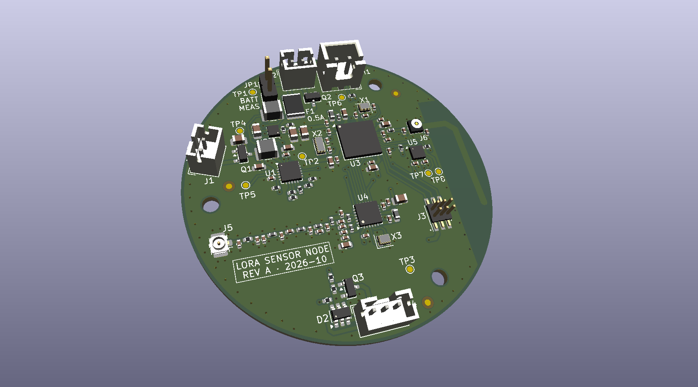
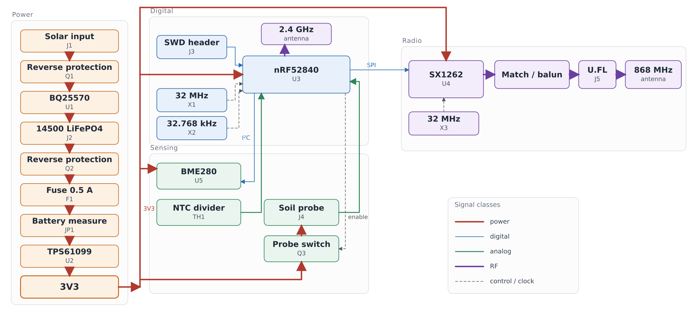
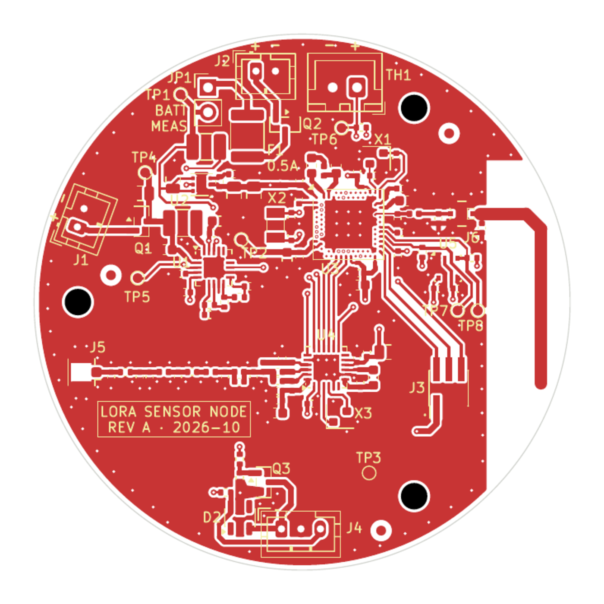
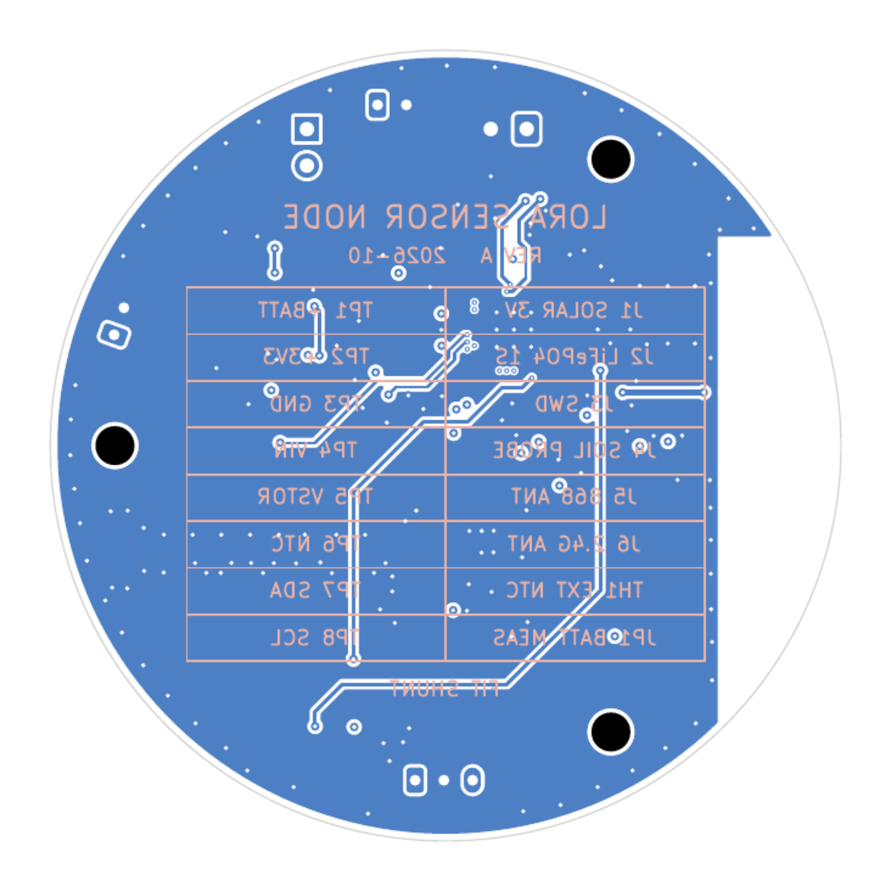
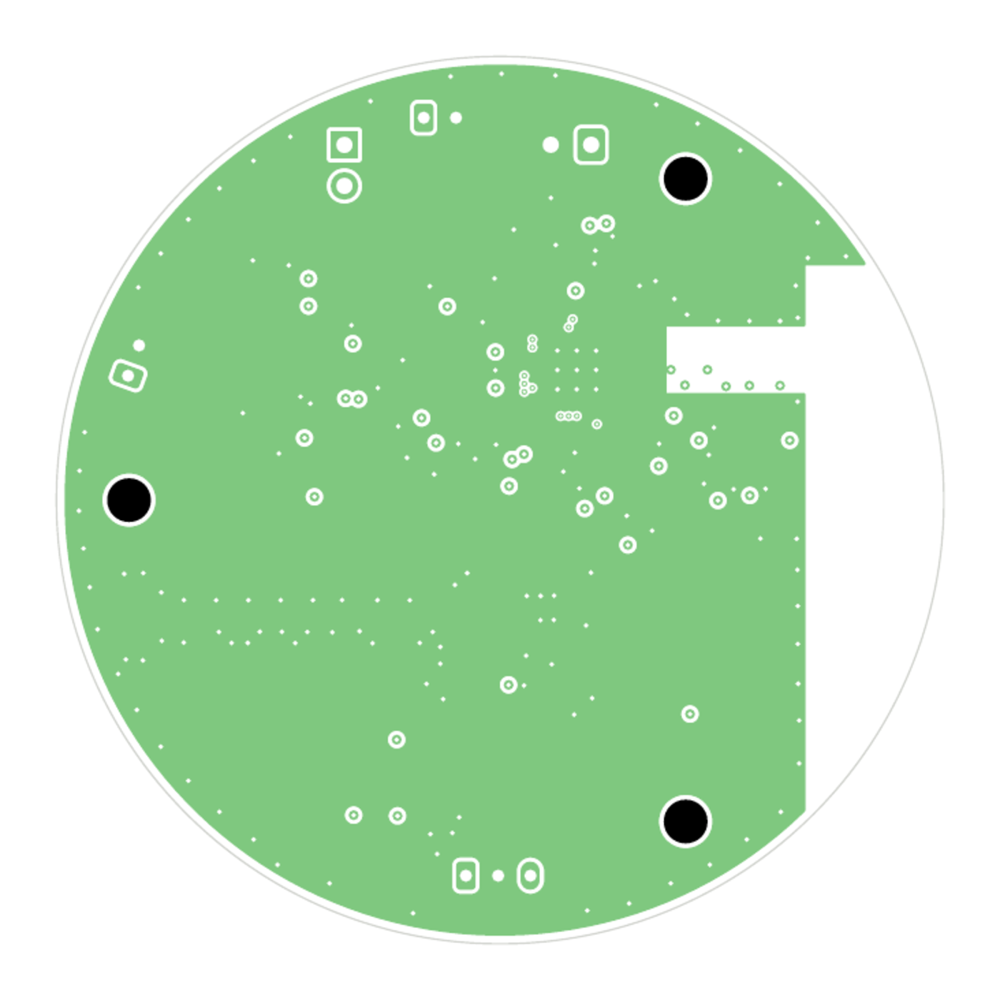
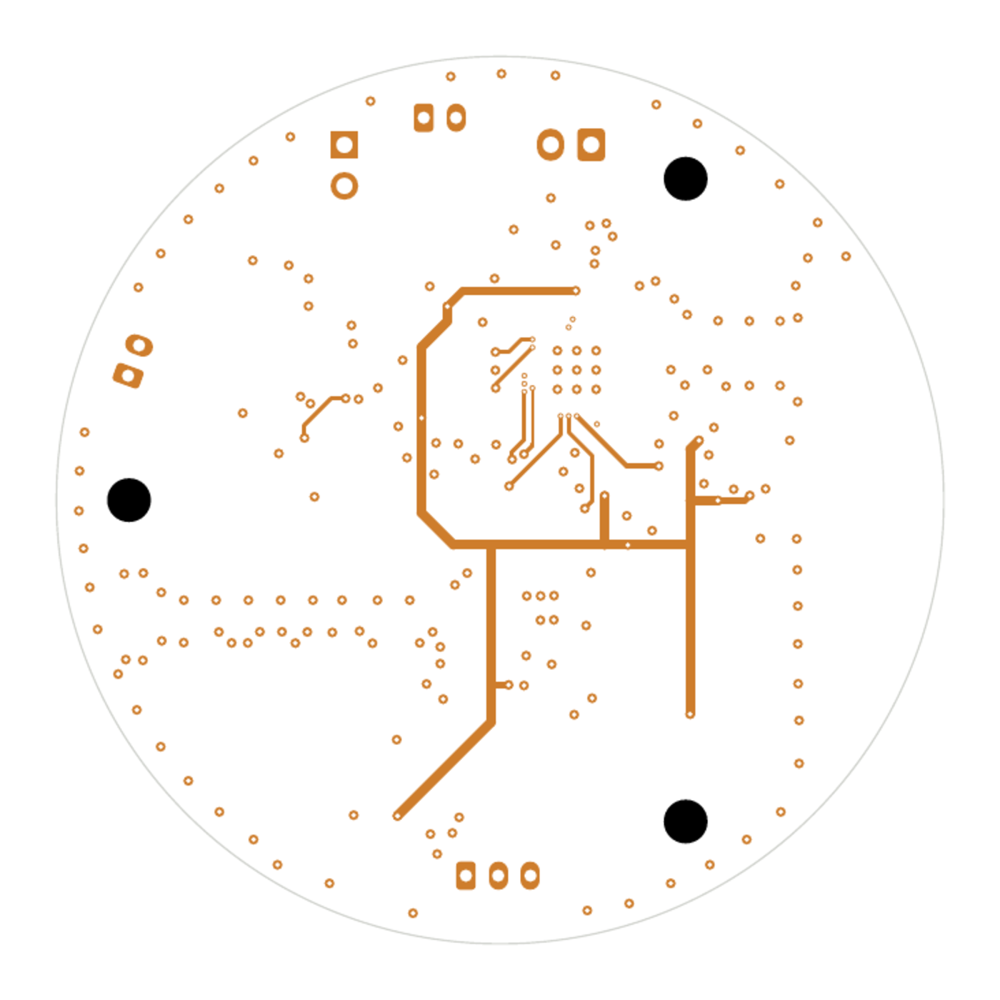

# Off-Grid Agricultural LoRa/BLE Sensor Node — Rev A

A 55 mm round, four-layer sensor node that runs from a solar cell and a 14500
LiFePO4 cell: 868 MHz LoRa, 2.4 GHz BLE, and an environmental sensor suite on
one board.



## Design viewer

| Schematic | Board |
|:---:|:---:|
| [Schematic, six pages (PDF)](docs/renders/schematic-rev-a.pdf) | [Open the board in KiCanvas][kicanvas-pcb] |

The PDF carries the whole hierarchy. KiCanvas is a read-only browser viewer for
the board, with no KiCad installation required.

[kicanvas-pcb]: https://kicanvas.org/?repo=https%3A%2F%2Fgithub.com%2FMehdi-Ldj%2Flora-ble-sensor-node%2Fblob%2Fmain%2Fhardware%2Frev-a%2Flora-node.kicad_pcb

## Overview

The node is meant to sit in a field and report microclimate data for months at a
time without a battery change. A solar harvester tops up a single LiFePO4 cell,
a boost holds 3.3 V, and the MCU wakes to sample temperature, humidity and soil
moisture before transmitting over LoRa.

Three choices shaped the board more than anything else:

- The radio is split. A bare nRF52840 runs BLE from a PCB antenna, while an
  SX1262 carries the long-range link through a U.FL connector, so the 868 MHz
  front end can be measured and re-matched without touching the MCU.
- The MCU is a bare aQFN73 at 0.4 mm pitch, fanned out directly on the top
  layer. No module, no fanout board.
- The RF feed is impedance-controlled. The 868 MHz path, the 2.4 GHz antenna
  feed and the U.FL launch all run in a 50 Ω net class over an In1.Cu plane, on
  a stackup chosen for that geometry.

The outline is the last constraint: Ø55 mm, three mounting holes, and an antenna
keepout that no layer may cross.

## Features

- **868 MHz** LoRa, discrete SX1262 with a switchless match/filter/balun and a
  U.FL measurement point
- **2.4 GHz** BLE from a bare **nRF52840** (aQFN73) with an on-board PCB antenna
- **BQ25570** solar harvester with PMOS reverse-polarity protection and TVS
- **TPS61099** 3.3 V boost from a single-cell 14500 LiFePO4
- Battery PTC, reverse-polarity protection, current-measure jumper and NTC divider
- **BME280** environment sensor and a switched analog soil probe
- SWD debug header, six test points, three fiducials
- 96 parts across five hierarchical sheets

## Board specifications

| Item | Value |
|---|---|
| Board size | **Ø 55.0 mm**, 4 layers |
| Stackup | **JLC04161H-7628**, FR4, Er 4.6, 1.6 mm nominal |
| Copper | 1 oz outer and inner, ENIG finish, green mask, white silk |
| Minimum feature | 0.20 mm track, 0.15 mm clearance, 0.20 mm drill |
| Vias | 0.30/0.20 mm and 0.20/0.20 mm, tented, no blind or buried |
| Impedance | 50 Ω ±10 % single-ended, In1.Cu reference |
| Assembly | JLCPCB Standard PCBA, 2 prototypes |

## Architecture



Line colour and weight separate the five signal classes: power, digital, analog,
RF and control. The 3V3 bus feeds the radio and the sensing block from the same
boost converter, and the soil probe is switched so it draws nothing while the
node sleeps.

## Design notes

### 868 MHz feed

The radio sheet carries a switchless match, filter and balun between the SX1262
and the U.FL, laid out as a 50 Ω coplanar waveguide over the In1.Cu ground plane.
The geometry was chosen from a quasi-static 2D sweep before layout:

| W (mm) | S (mm) | h (mm) | Z₀ (Ω) | εeff |
|---:|---:|---:|---:|---:|
| 0.38 | 0.20 | 0.210 | **50.4** | 3.51 |

The sweep and its caveats are in
[`simulation/results/cpw_sweep.md`](simulation/results/cpw_sweep.md). The
full-wave model and the VNA coupon are still to be run.

### 2.4 GHz antenna

The PCB antenna sits in a keepout with no copper on any layer, fed from the
nRF52840 through the same 50 Ω class. The keepout is the fragile part, and it is
documented with the stackup in [`docs/stackup.md`](docs/stackup.md).

### Power

The BQ25570 runs as a boost charger only — its buck converter is deliberately
unused — feeding a single LiFePO4 cell through a PTC and a reverse-polarity
PMOS. The TPS61099 then holds 3.3 V for the MCU, radio and sensors, and the soil
probe is switched so it cannot leak current while the node sleeps. The full pin
list and the reviewed net table are in the schematic.

### Package and assembly

Four layers carry the aQFN73 fanout on the top, a solid ground below it, and the
supplies on the inner layers. Assembly is Standard PCBA with X-ray, because the
aQFN73 and the BME280 both have pads underneath.

## Layout

| Front copper | Back copper |
|:---:|:---:|
|  |  |
| **Inner 1 — ground plane** | **Inner 2 — power** |
|  |  |

## Repository structure

| Path | Contents |
|---|---|
| `hardware/rev-a/` | KiCad 10 project: five schematic sheets, PCB, symbol and footprint libraries, 3D models |
| `simulation/` | Coplanar-waveguide pre-check for the 868 MHz feed, and the plan for the 3D model |
| `docs/` | [Assembly](docs/assembly-notes.md), [fabrication](docs/fab-notes.md) and [PCBA](docs/pcba-notes.md) notes, [stackup](docs/stackup.md), [impedance](docs/impedance.md), schematic PDF |
| `firmware/` | Reserved for the node firmware |

Open the project with KiCad 10:

```bash
kicad hardware/rev-a/lora-node.kicad_pro
```

## Fabrication and assembly

The board is drawn for JLCPCB 4-layer fabrication and Standard PCBA, with X-ray
inspection for the aQFN73 and BME280. Paste, stencil and panel choices are in
[`docs/fab-notes.md`](docs/fab-notes.md),
[`docs/assembly-notes.md`](docs/assembly-notes.md) and
[`docs/pcba-notes.md`](docs/pcba-notes.md).

The fabrication package for a release — gerbers, drill file, job file, BOM and
CPL — is attached to the release rather than committed here.

## Status

**Rev A is frozen and has not been fabricated yet.** The design is complete
through DRC, ERC and schematic/board parity. 
